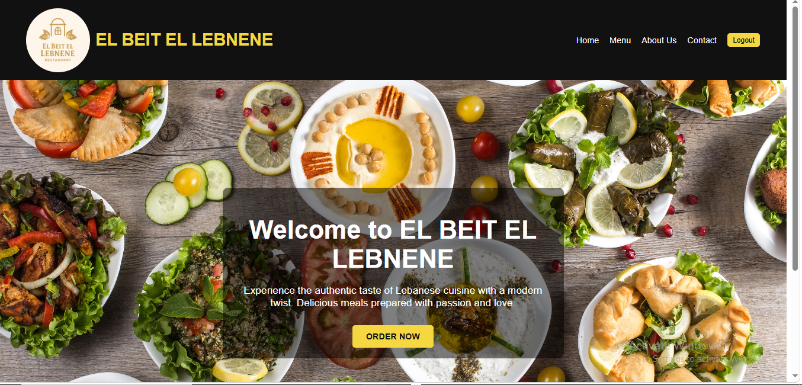
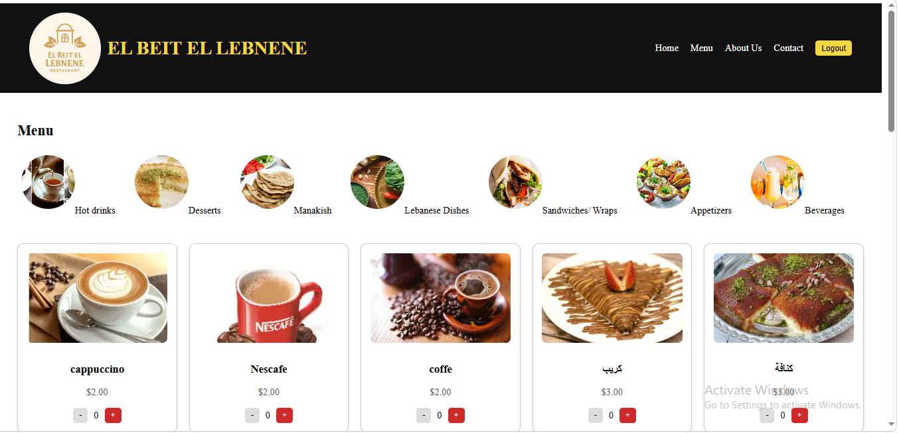
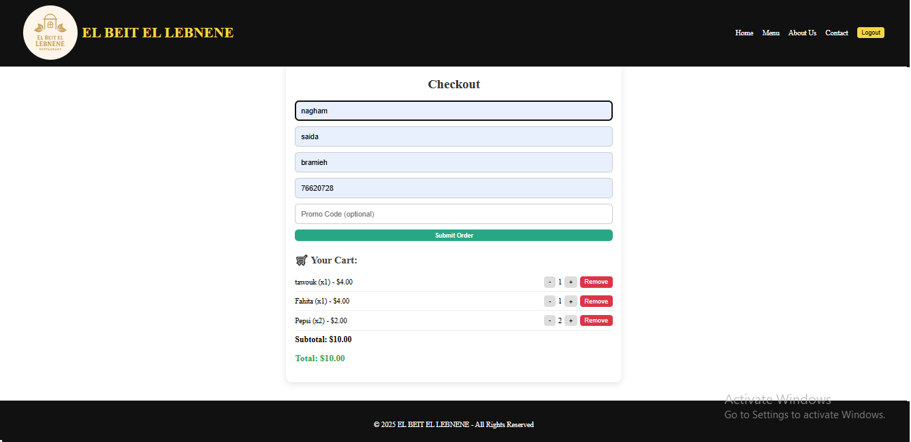
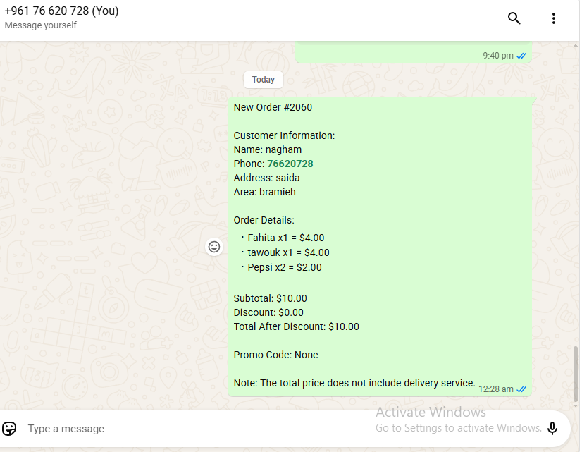
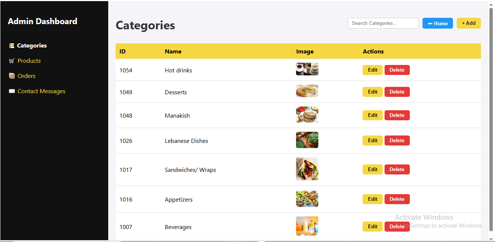

# El Beit El Lebnene – Restaurant Ordering App

A full-stack web app for a Lebanese restaurant: customers browse the menu, build a cart, apply a promo code and place an order, and an admin manages categories, products, orders and customer messages.

Built during my Full-Stack Web Development internship at LapTop (Saida, Lebanon), Feb–Apr 2026.

## Screenshots

| Home | Menu |
|---|---|
|  |  |

| Checkout | WhatsApp order summary |
|---|---|
|  |  |

| Admin dashboard |
|---|
|  |

## Features

- **Menu** grouped by category, with add-to-cart
- **Checkout** with delivery details, promo-code discounts, and an order summary that opens in WhatsApp for the restaurant owner
- **Orders and ordered items saved to SQL Server** through a REST API
- **Contact form** whose messages are stored in the database
- **Authentication:** sign up and login against the database, passwords hashed with bcrypt, JWT tokens, and role-based access (`user` / `admin`)
- **Admin dashboard** (admin-only, protected on both the page and the API) to create, edit and delete categories and products, view full order details (products, quantities, prices, notes), read contact messages, and search

## Tech stack

| Layer | Technologies |
|---|---|
| Frontend | React 19, Vite, React Router, Axios |
| Backend | Node.js, Express 5, `mssql` (msnodesqlv8), bcryptjs, cors, dotenv |
| Database | Microsoft SQL Server |

## Project structure

```
frontend/   React app (pages, components)
backend/    Express API (Routes, Controllers, config.js, app.js)
database/   SQL script for the ContactMessages table
```

## API overview

All routes are served under `/Admin`. Routes marked 🔒 require an admin token (`Authorization: Bearer <token>`).

| Resource | Endpoints |
|---|---|
| Auth | `POST /Admin/auth/login` (returns a JWT) |
| Categories | `GET /Admin/categories`; 🔒 `POST`, `PUT/DELETE /:id` |
| Products | `GET /Admin/products`; 🔒 `POST`, `PUT/DELETE /:id` |
| Users | `POST /Admin/users` (sign-up, always role `user`); 🔒 `GET`, `PUT/DELETE /:id` |
| Orders | `POST /Admin/orders`; 🔒 `GET`, `GET /:id/details`, `PUT/DELETE /:id` |
| Order items | `POST /Admin/order-items`; 🔒 `GET`, `PUT/DELETE /:id` |
| Contact messages | `POST /Admin/contact-messages`; 🔒 `GET`, `DELETE /:id` |

## Running it locally

**Requirements:** Windows, Node.js 18+, SQL Server (the `msnodesqlv8` driver uses Windows authentication through the SQL Server ODBC driver).

1. Create a SQL Server database named `INTERNSHIP` with the tables `Categories`, `Products`, `Users`, `Orders` and `OrderItems`. The `ContactMessages` table is created automatically by the API on first use (script also in `database/`).
2. Start the API:
   ```bash
   cd backend
   npm install
   copy .env.example .env      # then edit the connection string and JWT_SECRET
   node scripts/create-admin.js admin@example.com "YourStrongPassword" "Admin"
   npm start                   # http://localhost:3000
   ```
3. Start the frontend in a second terminal:
   ```bash
   cd frontend
   npm install
   npm run dev                 # http://localhost:5173
   ```

## Known limitations

This was a learning project, and these are the parts I would improve before using it in production:

- Tokens are kept in `localStorage` (an httpOnly cookie would be safer), and there is no refresh-token flow or rate limiting on login.
- Customers can place orders without logging in (guest checkout).
- Promo codes are defined in the frontend.
- The API URL (`http://localhost:3000`) is hard-coded in the frontend.
- The SQL scripts for the Categories, Products, Users, Orders and OrderItems tables are not included yet.

## Author

Nagham Fayez Ratrout, [github.com/ratroutnagham27-netizen](https://github.com/ratroutnagham27-netizen)
